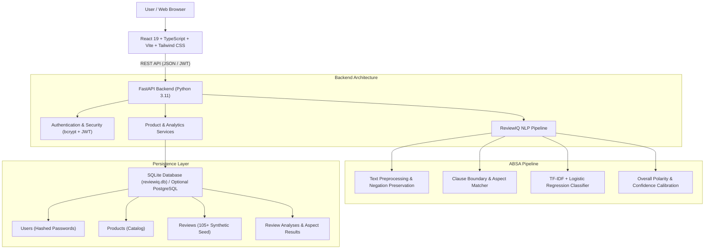

# ReviewIQ AI — System Architecture

## Overview
ReviewIQ AI is an end-to-end full-stack web application designed for fine-grained Aspect-Based Sentiment Analysis (ABSA) of customer smartphone reviews.

## Database Schema Design

### 1. `users` Table
- `id`: Integer primary key (autoincrement)
- `full_name`: String(128)
- `email`: String(255) unique, indexed
- `password_hash`: String(255) hashed using bcrypt
- `created_at`: DateTime (UTC)

### 2. `products` Table
- `id`: String(64) primary key (e.g. `prod_nova_x`)
- `name`: String(128) unique, indexed
- `category`: String(64)
- `description`: Text
- `created_at`: DateTime (UTC)

### 3. `reviews` Table
- `id`: String(64) primary key
- `product_id`: Foreign key -> `products.id`
- `review_text`: Text
- `rating`: Float (1.0 to 5.0)
- `source_type`: String(32) ('synthetic_demo', 'user_uploaded')
- `created_at`: DateTime (UTC)

### 4. `review_analyses` Table
- `id`: Integer primary key (autoincrement)
- `user_id`: Foreign key -> `users.id` (nullable, for user history isolation)
- `review_id`: Foreign key -> `reviews.id` (nullable)
- `product_id`: Foreign key -> `products.id` (nullable)
- `review_text`: Text
- `overall_sentiment`: String(32) ('Positive', 'Negative', 'Neutral', 'Mixed')
- `confidence`: Float (calibrated probability)
- `model_name`: String(64)
- `analysis_timestamp`: DateTime (UTC)

### 5. `aspect_results` Table
- `id`: Integer primary key (autoincrement)
- `analysis_id`: Foreign key -> `review_analyses.id` (ondelete CASCADE)
- `aspect_name`: String(64) ('Camera', 'Battery', 'Display', etc.)
- `sentiment`: String(32) ('Positive', 'Negative', 'Neutral', 'Mixed')
- `confidence`: Float
- `evidence_text`: Text (extracted linguistic cues)
